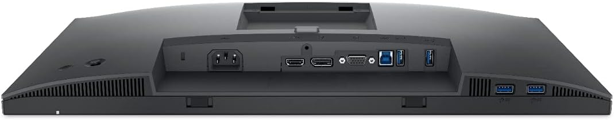

# Dell Hardware

- [Latitude 7490](latitude-7490/)
- [Optiplex 7060 micro](optiplex7060micro.html)

## Dell 22" FHD Monitor P2222H

[P2222H](https://www.amazon.com/dp/B096W3MV83)

## Dell UltraSharp 38" Curved USB-C Hub Monitor U3824DW

[Dell UltraSharp 38" U3824DW](https://www.dell.com/en-us/shop/monitors/apd/dell-ultrasharp-38-curved-usb-c-hub-monitor-u3824dw/u3824dw_withstand/-)

1. Security lock slot (based on Kensington Security Slot™)
1. Power connector
1. 2x HDMI 2.1
1. DisplayPort 1.4
1. USB Type-C upstream port (video and data). (Alternate mode with DisplayPort 1.4, Power Delivery up to 90W)
1. Audio line-out port
1. USB Type-C upstream port (data only, 10 Gbps, USB 3.2 Gen 2)
1. 4x USB Type-A downstream ports (SuperSpeed USB 10 Gbps, USB 3.2 Gen 2)
1. RJ45 Ethernet port, 2.5GbE
1. Stand lock
1. USB Type-A downstream port (SuperSpeed USB 10 Gbps, USB 3.2 Gen 2) with BC1.2 charging capability at 2A (max)
1. 2x USB-C downstream ports (SuperSpeed USB 10 Gbps, USB 3.2 Gen 2) with charging capability at 15W (max)
1. Speakers
1. Power On/Off button
1. Joystick
